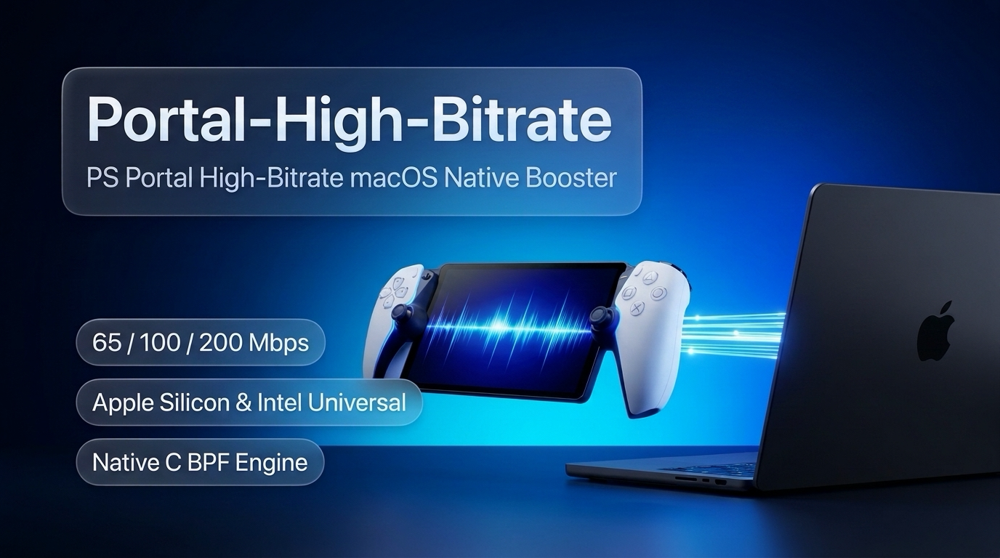

<div align="center">
  
  <h1>Portal-High-Bitrate</h1>
  <p><strong>专为 macOS 打造的 PS Portal 局域网高码率串流增强独立工具（Universal · Apple Silicon & Intel）</strong></p>

  <p>
    <a href="https://github.com/Rabbit-Spec/Portal-High-Bitrate-macOS/releases"></a>
    <a href="LICENSE"></a>
    
    <a href="https://space.bilibili.com/7135720"></a>
  </p>
</div>

<p align="center">
  
</p>

---

## 功能简介

`Portal-High-Bitrate` 是从 [**SysPulse**](https://github.com/Rabbit-Spec/macOS-SysPulse) 中独立拆分的 PlayStation Portal 高码率串流增强客户端，主程序与底层注入引擎均原生编译为 **Apple Silicon (`arm64`) + Intel (`x86_64`) 通用二进制**，支持 **macOS 13 Ventura 及以上系统**。

### 核心特性

- **开箱即用的原生 C BPF 引擎（Universal Mach-O）**
  - 内置无第三方依赖的原生引擎 `portal_engine`，无需安装 Python、Scapy 或 Xcode Command Line Tools。
  - 在局域网内拦截 UDP `9296` 的 `LaunchSpec` 握手参数，支持 **65 Mbps / 100 Mbps（推荐）/ 200 Mbps（极致）** 三档码率目标。
  - 基于 Protobuf 状态解析真实跟踪 PS5 回传的 `BANG`（Key Accepted）与连续 3 次高码率质量回报，握手结束后自动恢复 `IPCTL_SENDREDIRECTS`、`IPCTL_FORWARDING` 并广播 5 次反向 ARP 帧恢复点对点直连。
- **智能活跃网卡检测与一键设备扫描**
  - 自动过滤未连接、未启用或虚拟接口，结合 `SCNetworkInterfaceCopyAll()` 与默认网关路由自动识别并锁定当前活跃的 `无线局域网` 或 `以太网` 接口（支持手动切换及重新探测）。
  - 内置轻量级局域网扫描，自动高亮 Sony / PlayStation 设备，支持点击一键填入 PS5 IP 或 PS Portal IP。
- **首次授权、后续免密启动**
  - 首次使用管理员权限启动时，由 `portal_engine --install-sudoers` 对可执行文件绝对路径安全转义并经 `visudo -cf` 校验通过后写入 `/etc/sudoers.d/portal_high_bitrate`（`0440`），之后即可通过 `sudo -n` 静默免密秒启。
- **内置「关于 Portal-High-Bitrate」页面**
  - 可展示作者、Bilibili 频道、关联项目、致敬来源及本机运行的 CPU 架构（`Apple Silicon` / `Intel`）、硬件型号与 macOS 版本。

---

## 下载与安装

1. 前往 [**Releases**](https://github.com/Rabbit-Spec/Portal-High-Bitrate-macOS/releases) 页面下载 `Portal-High-Bitrate-v1.0.0.dmg`。
2. 双击打开 DMG 镜像，将 **`Portal-High-Bitrate.app`** 拖入 **`Applications`（应用程序）** 文件夹。
3. 首次打开若遇到 macOS 未签名应用提示，可在终端运行以下命令放行：
   ```bash
   sudo xattr -rd com.apple.quarantine /Applications/Portal-High-Bitrate.app
   ```

---

## 使用说明

1. 确保 Mac、PS5 和 PS Portal 处于**同一局域网**内。
2. 打开 `Portal-High-Bitrate`，确认顶部的活跃**网卡接口**正确，点击「**扫描局域网设备**」或手动填入 **PS5 IP** 与 **PS Portal IP**，选择目标码率（建议 `100 Mbps (推荐)`）。
3. 点击「**启动画质增强**」，看到终端日志出现 `[准备] ⚡️ 网络协商就绪！请在 120 秒内在 PS Portal 上点击连接 PS5...` 后，再在 PS Portal 上点击连接 PS5。
4. 握手确认完成后，程序会自动恢复 PS5 与 Portal 之间的局域网直连路由，后续串流不再经过 Mac 中转。

---

## 从源码编译（Universal Binary）

本仓库使用 **Swift 6 + SwiftUI + AppKit + C (BPF)** 编写，执行打包脚本即可一键生成通用二进制 `.app` 与 `.dmg`：

```bash
git clone https://github.com/Rabbit-Spec/Portal-High-Bitrate-macOS.git
cd Portal-High-Bitrate-macOS
./scripts/build_app.sh
```

编译完成后，通用版 `.app` 与 `.dmg` 产物位于 `../build/` 目录下。

---

## 作者与致谢

- **作者**：[Rabbit-Spec](https://github.com/Rabbit-Spec)
- **Bilibili 频道**：[汤圆_Lyric](https://space.bilibili.com/7135720)
- **关联主项目**：[Rabbit-Spec/macOS-SysPulse](https://github.com/Rabbit-Spec/macOS-SysPulse)
- **核心协议致敬**：[atameric/ps5-portal-high-bitrate](https://github.com/atameric/ps5-portal-high-bitrate)
- **开源协议**：本项目基于 [MIT License](LICENSE) 开源。
