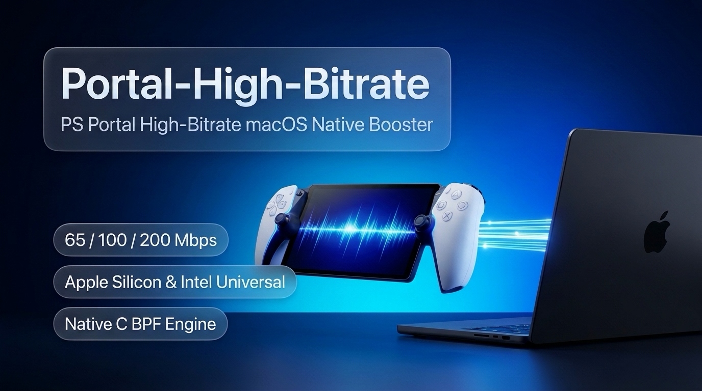

<div align="center">
  
  <h1>Portal-High-Bitrate</h1>
  <p><strong>专为 macOS 打造的 PS Portal 局域网高码率串流增强独立工具（Universal · Apple Silicon & Intel）</strong></p>

  <p>
    <a href="https://github.com/Rabbit-Spec/Portal-High-Bitrate-macOS/releases"></a>
    <a href="LICENSE"></a>
    
    <a href="https://space.bilibili.com/7135720"></a>
  </p>
</div>

<p align="center">
  
</p>

---

## 功能简介

`Portal-High-Bitrate` 是从 [**SysPulse**](https://github.com/Rabbit-Spec/macOS-SysPulse) 中独立拆分的 PlayStation Portal 高码率串流增强客户端，完整同步 **SysPulse v0.1.15（PS Portal 插件 v0.1.5）** 全部核心能力与全新 **PS Portal 串流插件浅/深色自适应图标**，主程序与底层注入引擎均原生编译为 **Apple Silicon (`arm64`) + Intel (`x86_64`) 通用二进制**，支持 **macOS 13 Ventura 及以上系统**。

### 核心特性

- **开箱即用的原生 C BPF 引擎（Universal Mach-O）**
  - 内置无第三方依赖的原生引擎 `portal_engine`，无需安装 Python、Scapy 或 Xcode Command Line Tools。
  - **方案 A / B 双模切换**：默认 **方案 A：单向视频直连**（仅劫持 Portal 上行握手，下行视频流全程直连不经 Mac 限速），也可切换 **方案 B：双向遥测验证**（跟踪 PS5 确认与连续 3 次高码率质量回报并在开播后自动交还直连）。
  - **IP 分片重组与自适应 LaunchSpec 注入**：内置 UDP/9296 IP 分片重组缓冲池（支持多片乱序重组与校验和重算），并在定长模板之外提供基于 JSON `bwKbpsSent` 的自适应等长回退注入，支持 **65 Mbps / 100 Mbps（推荐）/ 200 Mbps（极致）** 三档码率。
  - 采用内核级 `BIOCSETF` / `BIOCSETFNR` 过滤与 ARP 抢占应答，支持顶部「**恢复直连**」一键兜底复原。
- **全自动增强守望（Auto-Watch）与生命周期联动**
  - 支持开启顶部「**自动增强**」开关：平时零干扰只读 BPF 旁路守望，捕获 Portal 唤醒信号（ARP / UDP 9302 / DHCP / UDP 9296 / TCP 9295）并在 2 秒预检 PS5 在线后自动拉起 120 秒增强窗口；开播后自动切回静默直连、推送系统通知，并持续监测串流状态（PS5 待机或 Portal 离线时自动回落待命）。
  - 集成 `NWPathMonitor` 子网监测与系统休眠/唤醒联动：脱离家庭局域网或 Mac 休眠时自动复原直连并休眠守望，重回家庭网或唤醒后自动恢复；支持宿主进程退出时同步安全回收引擎。
- **智能活跃网卡检测、IEEE OUI 权威库与多协议设备识别**
  - 自动过滤虚拟接口，结合 `SCDynamicStore`（兼容 VPN / `utun` 场景）与 `SCNetworkInterfaceCopyAll()` 识别并锁定当前活跃物理网卡（支持以太网、无线局域网及雷雳网桥）。
  - 集成两阶段 DTIM 省电设备唤醒、`IP_BOUND_IF` 绑定、**PlayStation DDP (UDP 9302)**、**多协议自报（UPnP / mDNS / NetBIOS / DNS PTR）**、**TCP 9295/7000/8008 端口指纹**与 **5.4 万条离线 IEEE OUI 库**，结合置信度评分精准区分 **PS5 主机** 与 **PS Portal 掌机** 并支持跨网卡一键切换。
- **Debug 抓包诊断模式、安全特权通道与实时控制台**
  - 新增顶部 **Debug** 诊断开关与「**定位日志文件**」入口，开启后记录完整 ARP 包、IP 分片重组与 UDP/9296 十六进制握手详情，并同步落盘至 `~/Library/Logs/Portal-High-Bitrate/psportal.log`（2MB 自动轮转）。
  - 实时控制台支持 120 秒监听倒计时、20 秒冷却倒计时动态刷新、「**结束会话**」手动重置以及全周期状态徽章展示。
  - 首次管理员授权时安装受 `root:wheel` 保护的特权引擎至 `/Library/Application Support/Portal-High-Bitrate/portal_engine`，经 `visudo -cf` 校验写入 `/etc/sudoers.d/portal_high_bitrate`（`0440`），后续通过 `sudo -n` 静默免密秒启。
- **全新 PS Portal 插件视觉与 SysPulse 工具栏体验**
  - 应用主体、顶栏圆标、关于页与 Dock 图标同步换用 **PS Portal 串流插件浅/深色自适应艺术图标**，随系统外观自动切换。
  - 支持 **检查插件更新**、**打开插件目录**、**重新载入插件** 与 `manifest.json` 资源增量校验；采用与 SysPulse 一致的 `1200×822` 无标题栏居中液态玻璃导航。

---

## v0.1.5 更新要点（同步 SysPulse v0.1.15 / Portal 插件 v0.1.5）

- 新增 **全自动增强守望（Auto-Watch）**：支持旁路只读 BPF 唤醒监听、2 秒 PS5 在线预检、开播自动切回直连、系统通知及串流结束自动复位。
- 新增 **UDP/9296 IP 分片重组** 与 **JSON `bwKbpsSent` 自适应等长替换**，大幅提升不同固件与网络 MTU 下的握手改写成功率。
- 升级 **多协议局域网设备扫描**：集成 5.4 万条 `ieee_oui.tsv` 数据库、两阶段无线 DTIM 唤醒、UPnP/mDNS/NetBIOS/DNS PTR 自报及 TCP 9295/7000/8008 指纹评分。
- 新增 **Debug 抓包诊断模式**（含日志文件落盘与一键定位）、**`NWPathMonitor` 离家子网自动休眠**、**Mac 休眠/唤醒联动** 与 **退出同步回收引擎**。
- 强化 **特权引擎隔离校验**（`/Library/Application Support/Portal-High-Bitrate/portal_engine` + `proc_pidpath` + `route -n get` 校验）。
- 同步换用 **PS Portal 串流插件浅/深色自适应应用图标**（Dock / 顶栏 / 主卡片 / 关于页全面统一）。

---

## 下载与安装

1. 前往 [**Releases**](https://github.com/Rabbit-Spec/Portal-High-Bitrate-macOS/releases) 页面下载 `Portal-High-Bitrate-v0.1.5.dmg`。
2. 双击打开 DMG 镜像，将 **`Portal-High-Bitrate.app`** 拖入 **`Applications`（应用程序）** 文件夹。
3. 首次打开若遇到 macOS 未签名应用提示，可在终端运行以下命令放行：
   ```bash
   sudo xattr -rd com.apple.quarantine /Applications/Portal-High-Bitrate.app
   ```

---

## 使用说明

1. 确保 Mac、PS5 和 PS Portal 处于**同一局域网**内。
2. 打开 `Portal-High-Bitrate`，确认顶部的活跃**网卡接口**正确，点击「**扫描局域网设备**」或手动填入 **PS5 IP** 与 **PS Portal IP**，选择目标码率（建议 `100 Mbps (推荐)`）。
3. 可点击「**启动画质增强**」手动监听 120 秒，或开启顶部「**自动增强**」实现 Portal 唤醒即自动拦截增强。
4. 握手确认完成后，程序会自动恢复 PS5 与 Portal 之间的局域网直连路由，后续串流不再经过 Mac 中转。

---

## 从源码编译（Universal Binary）

本仓库使用 **Swift 6 + SwiftUI + AppKit + C (BPF)** 编写，执行打包脚本即可一键生成通用二进制 `.app` 与 `.dmg`：

```bash
git clone https://github.com/Rabbit-Spec/Portal-High-Bitrate-macOS.git
cd Portal-High-Bitrate-macOS
./scripts/build_app.sh
```

编译完成后，通用版 `.app` 与 `.dmg` 产物位于 `../build/` 目录下。

---

## 作者与致谢

- **作者**：[Rabbit-Spec](https://github.com/Rabbit-Spec)
- **Bilibili 频道**：[汤圆_Lyric](https://space.bilibili.com/7135720)
- **关联主项目**：[Rabbit-Spec/macOS-SysPulse](https://github.com/Rabbit-Spec/macOS-SysPulse)
- **核心协议致敬**：[atameric/ps5-portal-high-bitrate](https://github.com/atameric/ps5-portal-high-bitrate)
- **开源协议**：本项目基于 [MIT License](LICENSE) 开源。
